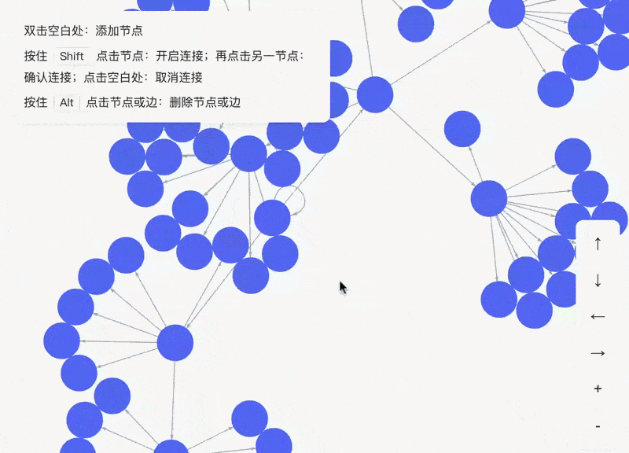
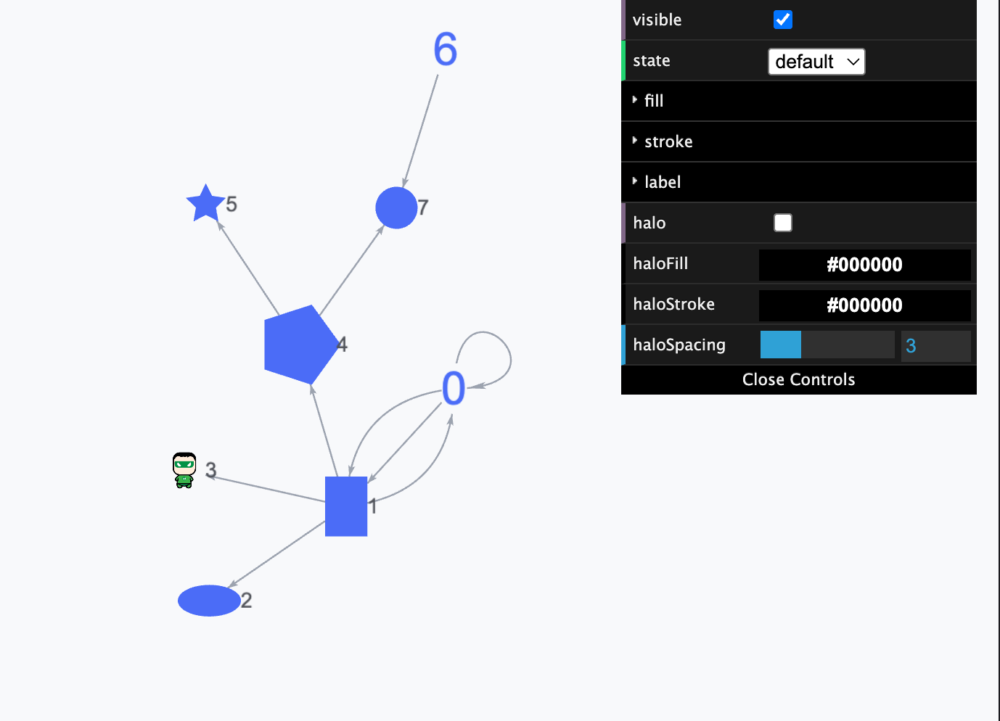
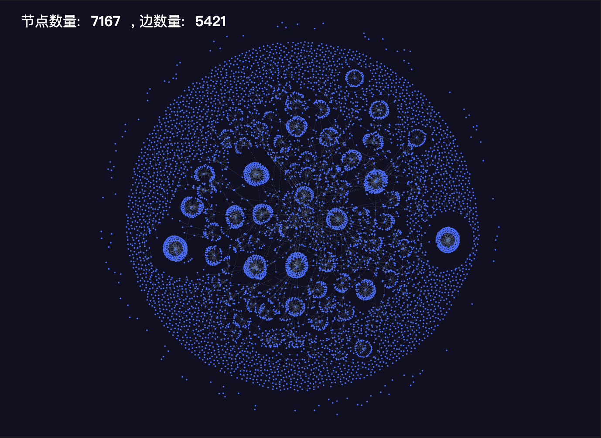

[中文](README.zh-CN.md) | English

# GraphVis

A high-performance graph visualization library based on [PixiJS](https://github.com/pixijs/pixijs), supporting smooth rendering of tens of thousands of nodes and edges.

<p align="center">
  
</p>

<p align="center">
  
  &nbsp;&nbsp;
  
</p>

<p align="center">
  <a href="https://zjfcool.github.io/graph-vis/en/guide/introduction/">Guide</a> •
  <a href="https://zjfcool.github.io/graph-vis/en/api/graph/">API</a> •
  <a href="https://zjfcool.github.io/graph-vis/en/demos/">Examples</a>
</p>

## Features

- **High Performance**: Based on PixiJS rendering, easily supports tens of thousands of nodes and edges.
- **Data-Driven**: Properties support dynamic generation via functions, styles change in real-time with data.
- **Extensible**: Supports custom nodes, edges, layouts, and themes.
- **Rich Interactions**: Built-in zoom, pan, drag, link drawing, and a complete event system.
- **Multiple Layouts**: Built-in d3-force and random, supports custom extensions.
- **Multiple Rendering Modes**: Nodes and edges support both Graphics and Sprite rendering.
- **Multiple Node Types**: Built-in circle, ellipse, rectangle, polygon, star, image, text, etc.

## Quick Start

### Installation

```bash
npm install pixi.js @zjfcool/graph-vis
```

### Basic Usage

1. Prepare a container in HTML:

```html
<div id="container" style="width: 500px; height: 500px;"></div>
```

2. Initialize GraphVis in JavaScript:

```javascript
import { GraphVis } from "@zjfcool/graph-vis";

const data = {
  nodes: [
    // Node data
  ],
  edges: [
    // Edge data
  ],
};

async function init() {
  const container = document.querySelector("#container");
  const graph = new GraphVis({
    container,
    data, // default: { nodes: [], edges: [] }
    width: container.clientWidth,
    height: container.clientHeight,
  });
  await graph.init();
}

init();
```

## License

[MIT](LICENSE)